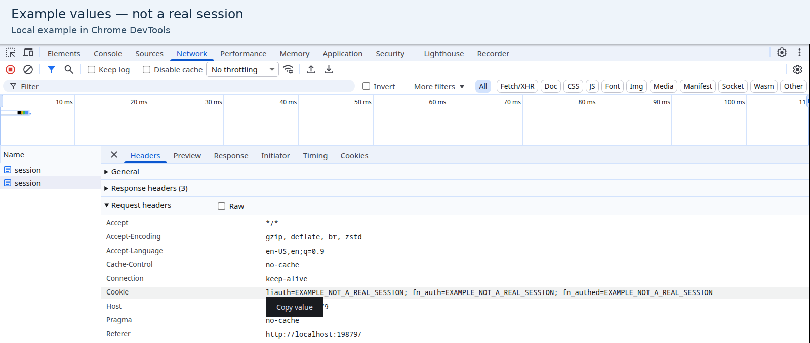
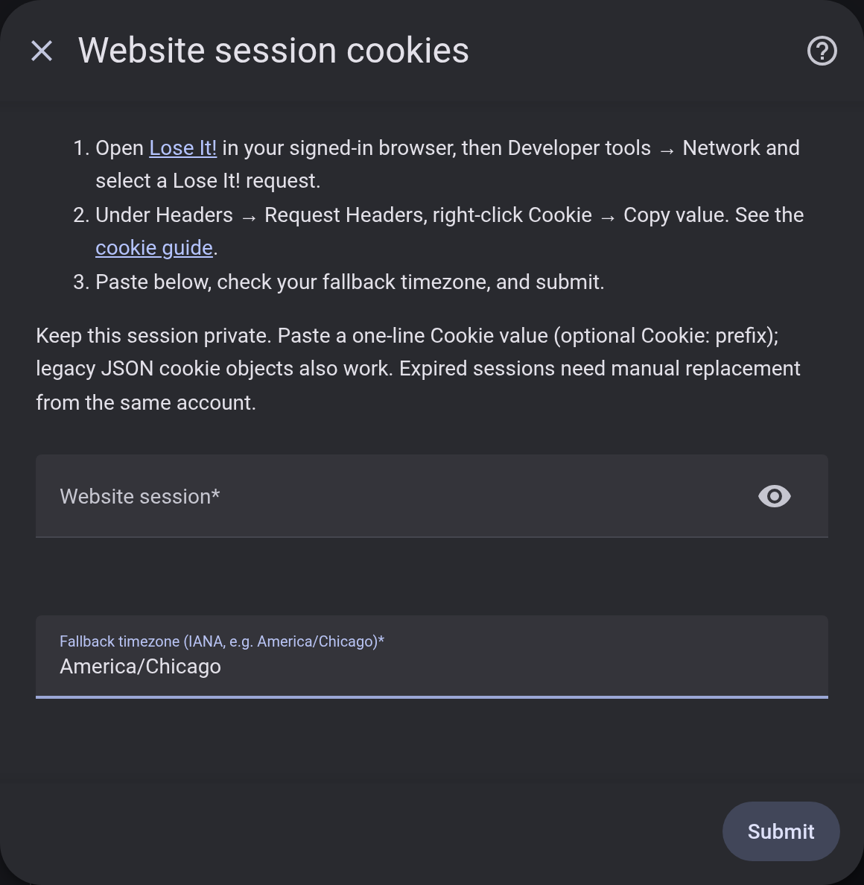

# Connect Lose It! with one paste

Copy one value from your signed-in browser into HA. No JSON editing, extensions
or console scripts are needed. **The copied value is a sign-in credential:** paste
only into your own HA, never into chat, issues, screenshots or an online converter.

## 1. Copy the website session

In Chrome, Edge or Helium on a desktop computer:

1. Open [Lose It!](https://www.loseit.com/) in your signed-in browser profile.
   Keep an existing session; do not log out or reset a password to test setup.
2. Open Developer tools: **Ctrl + Shift + I** (Windows/Linux) or
   **Command + Option + I** (macOS). Select **Network**, then refresh.
3. Select a request to `www.loseit.com` or `my.loseit.com`. Open **Headers** and
   find **Cookie** under **Request Headers**.
4. Right-click the **Cookie** row → **Copy value**.

*Real browser UI with explicitly synthetic example values, not a real session.*

Copy the whole value—not individual cookies, **Copy as cURL**, **Copy all request
headers** or a response's **Set-Cookie**. The integration extracts supported session
cookies and does not save unrelated advertising/analytics cookies from the header.

**No Cookie row?** Check the browser profile, refresh with Developer tools open,
and select another website request rather than an image/analytics host. If you
have no existing session, sign in normally on the official website first.

Firefox also exposes **Developer tools → Network → request → request headers**;
copy its **Cookie** value. Menu labels may differ.

## 2. Paste into Home Assistant

Open **Settings → Devices & services → Add integration → Lose It!**. Paste into
**Website session**, keep the suggested timezone and select **Submit**. Clear your
clipboard afterward. Do not add braces, quotes or cookie names by hand.

*Empty setup form; no real cookie values or account details.*

## If setup fails

| Message | What to check |
| --- | --- |
| Invalid input | Copy the complete **Cookie → Copy value** result, not a URL, response headers or a single cookie's bare value. |
| Invalid or expired session | Copy the current header from the signed-in browser profile. |
| Cannot connect | Wait and check the official website. Challenges or website changes are not solved by repeated submissions. |
| Rate limited | Wait before retrying; reopening setup does not bypass the cooldown. |
| Already configured | Use the existing entry rather than adding the same account twice. |
| Wrong account | Copy from the account already connected to this entry. Failed replacements leave stored access unchanged. |

Use an IANA timezone such as `America/Chicago`, not `CST`. **Renewal is manual:**
when HA requests reauthentication, repeat these steps for the same account without
deleting the entry or its entities. Email/password login is not supported.

Advanced: existing JSON imports

A nonempty JSON object mapping cookie names to string values remains supported.
A copied header needs no conversion; an optional `Cookie:` prefix is accepted.
Do not decode or edit cookie values.

HA stores the session in configuration and potentially backups. Restrict access
and encrypt backups. See [privacy and security](../SECURITY.md) and
[known limitations](limitations.md).
